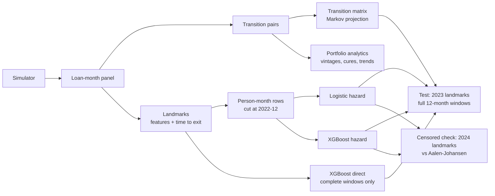
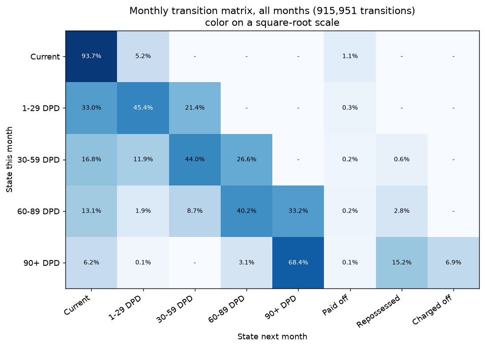
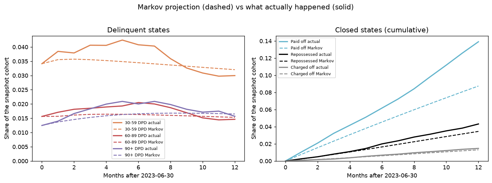
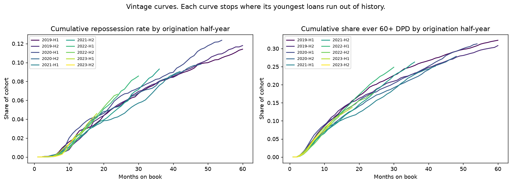
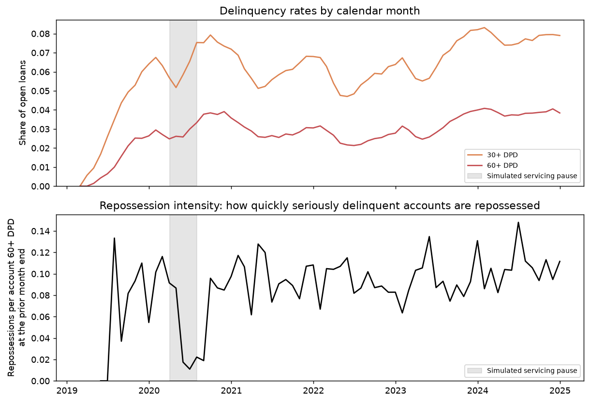
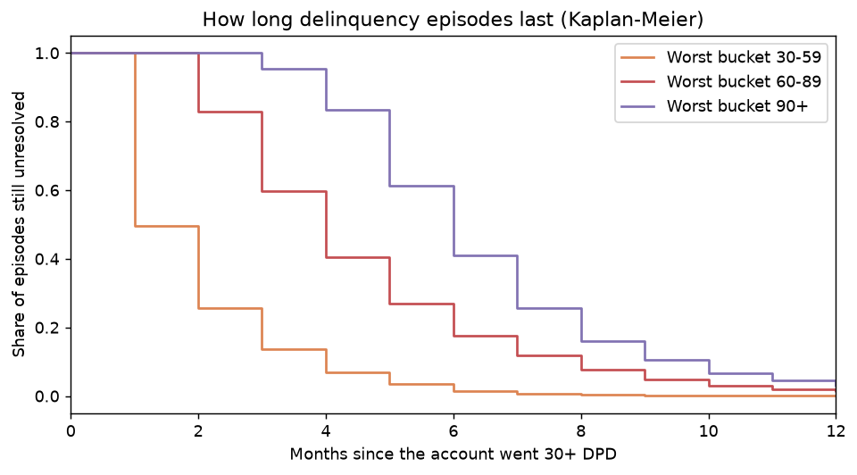
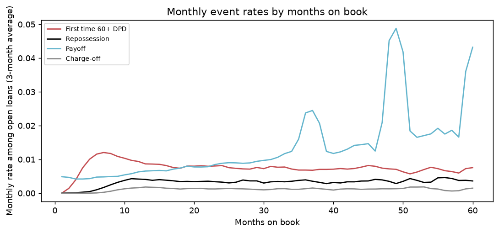
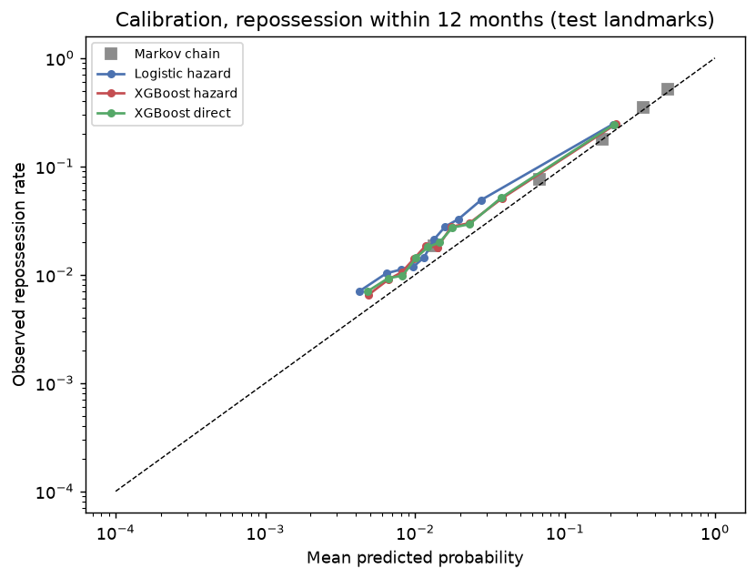
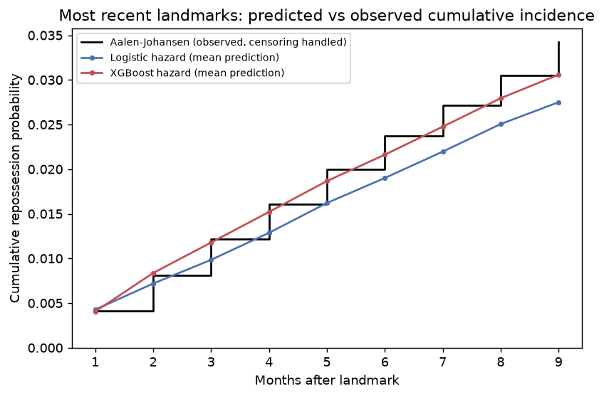

# Auto Loan Repossession Risk and Delinquency Transitions

How auto loans move between payment statuses over time, and how likely an open loan is to be
repossessed within the next 12 months.

This is an independent portfolio project. It runs entirely on synthetic data from a simulator
included in this repository. It is not a system built for or used by any employer, it does not
reproduce any company's models or servicing rules, and it has not been validated on real loans.

> **Read this first.** Every number below comes from simulated loans with simulated servicing rules.
> The results show that the methods are implemented and tested correctly. They say nothing about
> real repossession rates or real model performance. This is not a servicing or collections tool.

## 1. Business problem

Two related questions about a portfolio of auto loans:

1. **Portfolio dynamics.** Each month, what share of accounts in each delinquency bucket cures, stays
   or rolls forward? How do different origination cohorts compare at the same age? How long does
   delinquency last?
2. **Repossession risk.** For a loan that is open today, what is the probability that the vehicle is
   repossessed within 12 months?

This is a different problem from a standard classification task, for three reasons:

- **Timing matters.** A loan can be repossessed next month or in three years.
- **There are competing exits.** A loan that pays off can no longer be repossessed.
- **The data is censored.** For loans still open when the data ends, we do not know the final outcome.

Three terms I keep separate throughout:

| Term | What it is here |
|---|---|
| Delinquency | A payment status: the account is some number of days past due. |
| Default | A definition: first time 120+ days past due, or repossessed, or charged off. |
| Repossession | A servicer action: the vehicle is recovered. It depends on the borrower and on servicing policy, capacity and whether the vehicle is found. |

In the simulated portfolio, 7,473 of 30,000 loans were ever 60+ days past due, 4,165 defaulted, and
2,728 were repossessed. They are clearly not the same set.

## 2. Data

I looked for public auto loan data with monthly payment status and repossession events. The public
Kaggle-style datasets are origination snapshots with a default flag. The SEC's ABS-EE loan-level
filings for auto securitizations are the one serious public source, but they are large XML files and
cover only securitized pools. I used a simulator instead and may add ABS-EE later.

The simulator (`src/autoloan_sim`) creates 30,000 loans originated from 2019 through 2023 and follows
them monthly through December 2024: about 946,000 loan-months and 916,000 month-to-month transitions.
[`data/DATA_DICTIONARY.md`](data/DATA_DICTIONARY.md) documents every column and assumption.

What matters for this project:

- Borrowers have a hidden stress state that drives missed payments.
- **Repossession is simulated as a servicing process.** Accounts 60+ days past due are assigned for
  repossession with a probability that depends on the delinquency bucket, on one of three servicing
  groups (A is fastest, C is slowest), and on a monthly capacity factor. About 8% of vehicles are
  never found. Borrowers can also surrender the vehicle.
- There is a **four-month servicing pause** in 2020 when almost nothing is assigned for repossession.
- Accounts 150+ days past due that are not repossessed are charged off.
- 57% of loans are still open at the data cutoff, so censoring is everywhere.

## 3. Methods

### A. Transition matrix and Markov projection

Eight states: current, 1-29, 30-59, 60-89 and 90+ days past due, plus three closed states (paid
off, repossessed, charged off). I estimate the monthly transition matrix by counting moves, then use
it for roll rates, multi-month projections, and the probability of repossession within a horizon.

### B. Discrete-time hazard model (logistic)

Each open loan-month ("landmark") is expanded into one row per month of follow-up. A multinomial
logistic regression predicts what happens in each month: stay open, repossessed, paid off, or charged
off. A loan that is still open when the data ends just stops contributing rows, which is how
censoring is handled. The 12-month repossession probability is built up month by month as
"still open so far" times "repossessed this month", so payoff and charge-off correctly reduce it.

### C. Gradient-boosted models

- **XGBoost hazard:** the same person-month setup with a multi-class XGBoost model.
- **XGBoost direct:** a plain yes/no classifier for "repossessed within 12 months", fitted only on
  landmarks whose full 12-month window had been observed. This is the common shortcut, included for comparison.

### Why these

The Markov chain is the standard portfolio tool and a fair baseline: it uses only the current status.
The logistic hazard is the interpretable way to add loan age, history and servicing information.
XGBoost tests whether non-linear effects add anything. The direct classifier shows what the simpler
approach costs and what it does not.

## 4. Modeling assumptions, and where they break

**Markov chain.** Two assumptions: next month depends only on this month's state, and the
probabilities are the same every month. I tested both ([report](reports/portfolio_report.md), section 5):

- *History matters.* Among accounts at 60-89 days past due, those that just rolled in from a better
  bucket roll forward again 39.8% of the time. Those that came back from 90+ roll forward 15.6% of the time.
- *Time matters.* During the simulated servicing pause, the monthly chance that a 90+ account was
  repossessed fell from about 15% to 2.6%.
- *Age matters.* Payoff gets more likely as loans age, and the chain cannot see age. Its "eventual"
  repossession rate for a current loan is 23.6%, while the 2019 loans are at 12.1% with a fifth still open.

**Hazard models.** Covariates are frozen at the landmark. Follow-up months are treated as
conditionally independent given the features. Censoring is assumed to be unrelated to risk, which
holds here because the only censoring is the end of the data.

**All models** learn repossession under the servicing policies in the data. See section 10.

## 5. Feature engineering

26 features, all from data on or before the landmark month
([`src/repo_risk/features.py`](src/repo_risk/features.py)):

- **Loan age and balance:** months on book, remaining term, balance ratio, current LTV.
- **Delinquency now:** days past due, payments behind, months in the current 30+ episode.
- **History:** missed payments over 3 and 6 months, worst days past due over 6 months and ever, months
  30+ in the last year, number of episodes, months since last 30+, paid-to-due ratios, extensions.
- **Servicing:** whether the account is already assigned for repossession, and the servicing group.
- **Origination:** credit score, PTI, LTV, APR, term, new/used.

A test deletes all data after a date and checks that features for that date do not change.

## 6. Training and evaluation strategy



- **Out-of-time.** Nothing after December 2022 is used for fitting. For the hazard models, follow-up
  is cut at that date even where later months are known.
- **Complete-window test.** Test landmarks are from 2023. Every one has 12 full months of follow-up
  before the data ends, so each has a known yes/no answer and ROC-AUC, PR-AUC and Brier score are
  valid. Loans that paid off inside the window are known "no" cases.
- **Censored check.** Landmarks from 2024 do not have full windows. For those I do not compute
  classification metrics. I compare the mean prediction with the Aalen-Johansen estimate, which
  handles censoring and competing exits.
- **Window completeness is decided by the calendar only.** It is tempting to keep recent landmarks
  whose loan happened to close early, since their outcome is known. That keeps early exits and drops
  survivors, which inflates the event rate. There is a test for this.
- **Held-out loans.** 15% of loans are never used for fitting. They are used for early stopping and
  reported separately in the test.
- **Search budget.** 4 random configurations for the XGBoost hazard and 6 for the direct classifier.
  The full pipeline runs in about 2.5 minutes on my machine.

## 7. Results

Full reports: [`reports/portfolio_report.md`](reports/portfolio_report.md) and
[`reports/model_evaluation.md`](reports/model_evaluation.md).

### Transition matrix (monthly, all months)

| From \ To | Current | 1-29 | 30-59 | 60-89 | 90+ | Paid off | Repossessed | Charged off |
|---|---:|---:|---:|---:|---:|---:|---:|---:|
| Current | 93.66% | 5.21% | | | | 1.13% | | |
| 1-29 DPD | 32.96% | 45.36% | 21.42% | | | 0.26% | | |
| 30-59 DPD | 16.78% | 11.87% | 43.95% | 26.62% | | 0.21% | 0.56% | |
| 60-89 DPD | 13.07% | 1.87% | 8.68% | 40.15% | 33.23% | 0.24% | 2.76% | |
| 90+ DPD | 6.23% | 0.12% | | 3.08% | 68.39% | 0.13% | 15.19% | 6.85% |

### Markov projection against what happened

I took the 19,893 loans open at the end of June 2023, estimated the matrix from earlier months only,
and projected 12 months ahead.

| After 12 months | Actual | Markov | Error |
|---|---:|---:|---:|
| Current | 66.75% | 72.38% | +5.64 pts |
| 30+ DPD (three buckets) | 6.03% | 6.38% | +0.35 pts |
| Paid off | 13.91% | 8.75% | -5.16 pts |
| Repossessed | 4.32% | 3.45% | -0.87 pts |
| Charged off | 1.47% | 1.30% | -0.17 pts |

The delinquent buckets come out close. Payoffs are badly underestimated, because the book was older
in 2023 than in the history behind the matrix, and older loans pay off more. Repossessions are
underestimated by about a fifth.

### Portfolio analytics highlights

- **Cures.** 97.9% of episodes that never got past 30-59 days cured. Of episodes that reached 90+,
  25.1% cured, 52.0% ended in repossession and 22.4% in charge-off.
- **Duration.** Median episode length (Kaplan-Meier, open episodes censored) is 1 month for episodes
  that stay in 30-59, 4 months for 60-89, and 6 months for 90+.
- **Vintages.** Cumulative repossession by 24 months on book ranges from 4.2% (2021-H1) to 6.7%
  (2022-H2). The 2022 cohorts are the highest, which matches the looser underwriting in the simulator.
- **Servicing.** Of loans that reached 60+ days past due, group A repossessed 39.1%, group B 34.5% and
  group C 27.0%. The borrowers are the same on average. Only the servicing speed differs.

### Repossession within 12 months (test: 79,713 landmarks from 2023, 4.30% repossessed)

| Model | ROC-AUC (95% CI) | PR-AUC (95% CI) | Brier | Mean predicted | Observed |
|---|---|---|---:|---:|---:|
| Markov chain | 0.770 (0.761-0.778) | 0.244 (0.227-0.260) | 0.0348 | 3.71% | 4.30% |
| Logistic hazard | 0.824 (0.815-0.833) | 0.324 (0.303-0.343) | 0.0344 | 3.24% | 4.30% |
| XGBoost hazard | 0.824 (0.816-0.833) | 0.330 (0.311-0.350) | 0.0340 | 3.51% | 4.30% |
| XGBoost direct | 0.823 (0.814-0.831) | 0.325 (0.307-0.345) | 0.0342 | 3.47% | 4.30% |

Within those 12 months, 14.2% of the landmarks paid off and 1.5% were charged off.

What I take from this:

**Features beat status alone, but the three feature-based models are tied.** All three rank clearly
better than the Markov chain. Between them, the intervals overlap almost completely.

**Every model predicts too few repossessions for 2023.** This is the most important result. The
models were fitted on 2019-2022, which includes the servicing pause and lower delinquency. In 2023-24
delinquency ran higher. The shortfall is biggest for accounts that were current at the landmark
(1.86% observed against about 1.3-1.4% predicted). An out-of-time test shows this. A random split would
have hidden it. The practical answer is regular recalibration and monitoring.

**The logistic hazard has a specific weak spot.** For accounts 1-29 days past due it predicts 3.4%
against 7.6% observed. The tree models predict about 5.7%. A linear model has trouble with the jump
in risk between "current" and "a little behind".

**Short horizons are easy to rank.** At 3 months, ROC-AUC is 0.984 for the Markov chain and 0.988 for
the XGBoost hazard, because short-term repossession is almost all about who is already deeply
delinquent. PR-AUC still separates them (0.334 against 0.534).

**Hazard model or direct classifier?** Same accuracy at 12 months. The direct classifier had to
drop 50,224 of 125,674 training landmarks because their 12-month labels were not complete yet. The
hazard models used all of them, and one hazard model gives every horizon from 1 to 12 months plus
payoff and charge-off probabilities. The direct classifier is much simpler and fits in under a second.

### Censored check (77,038 landmarks from 2024, 9-month horizon)

73% of these landmarks have less than 9 months of follow-up.

| Estimate of the 9-month repossession rate | Value |
|---|---:|
| Aalen-Johansen (handles censoring and competing exits) | 3.42% |
| Naive: count "not repossessed yet" as "not repossessed" | 2.13% |
| Only landmarks with 9 full months (n = 21,061) | 3.46% |
| Mean prediction, logistic hazard | 2.75% |
| Mean prediction, XGBoost hazard | 3.06% |

The naive number is off by more than a third. This is the mistake that ordinary classification
metrics make on censored data. The models rank well here too: the top third of predicted risk has
a 9.2% Aalen-Johansen rate, the bottom third 0.4%.

## 8. Visualizations

| | |
|---|---|
|  |  |
|  |  |
|  |  |
|  |  |

More in [`figures/`](figures). Notebooks (already executed):

- [`01_transitions_and_portfolio_analytics.ipynb`](notebooks/01_transitions_and_portfolio_analytics.ipynb)
- [`02_repossession_risk_models.ipynb`](notebooks/02_repossession_risk_models.ipynb)

## 9. How to reproduce

Python 3.10 or newer.

```bash
git clone <this repository>
cd auto-loan-repossession-risk
python -m venv .venv
source .venv/bin/activate          # Windows: .venv\Scripts\activate
pip install -e ".[dev,app,notebooks]"

pytest -q                                  # about 15 seconds
python -m repo_risk.cli run-all            # simulate, report, landmarks, train, evaluate (~2.5 min)
streamlit run app/streamlit_app.py         # dashboard
```

A quick smoke run on 3,000 loans: `python -m repo_risk.cli run-all --config configs/small.yaml`.
Single steps: `generate`, `report`, `landmarks`, `train`, `evaluate`.

The simulator and the search are seeded. Metrics can move in the third decimal across library
versions or machines.

```
src/autoloan_sim/   synthetic data simulator (shared with my two other auto finance projects)
src/repo_risk/      transitions, analytics, features, hazard models, training, evaluation, report, CLI
app/                Streamlit dashboard
configs/            default and small run settings
notebooks/          two executed notebooks
reports/            generated portfolio report and model evaluation
figures/            generated plots
tests/              38 tests (simulator, transitions, hazards and censoring, analytics, pipeline)
```

Some of the tests check the statistics directly: the cumulative incidence against a closed-form
answer, my Aalen-Johansen estimator against `lifelines`, and both hazard models against a simulated
hazard that I know the answer to.

## 10. Limitations and responsible use

- **Repossession is not only borrower behavior.** In this data, and in real life, repossession
  depends on servicing policy, staffing, legal requirements and whether the vehicle can be located.
  These models predict "repossessed under the policies in the data". If the policy changes, the
  model is wrong even if borrowers behave the same. The 2020 pause in the simulation shows this.
- **Selection bias in the label.** A repossession is observed only if the servicer chose to pursue
  the account and found the vehicle. Loans charged off because the vehicle was never found count as
  "not repossessed", though the borrower behaved the same way. The model cannot separate the two, and
  neither can an observed-outcome model on real data. An unbiased estimate of "would be repossessed
  if pursued" would need data on assignment decisions and a causal design, which is out of scope here.
- **Not causal.** The models cannot say what would happen if an account were treated differently.
- **Synthetic data.** I wrote the process that generates the outcomes. Real portfolios have
  bankruptcies, insurance losses, redemptions, reinstatements and post-charge-off recoveries that
  the simulator leaves out.
- **Calibration drifted** in the test period, as shown above. I report it as is.
- **Frozen covariates.** The hazard models do not forecast how features will change.
- **Not a decision system.** No fair lending review, no compliance review, no validation. The
  dashboard shows aggregate views only on purpose.

What I would do next: refit on a rolling window and track calibration over time, model assignment
and recovery as two separate steps, and test the same code on SEC ABS-EE data.

## License

MIT. See [`LICENSE`](LICENSE).
